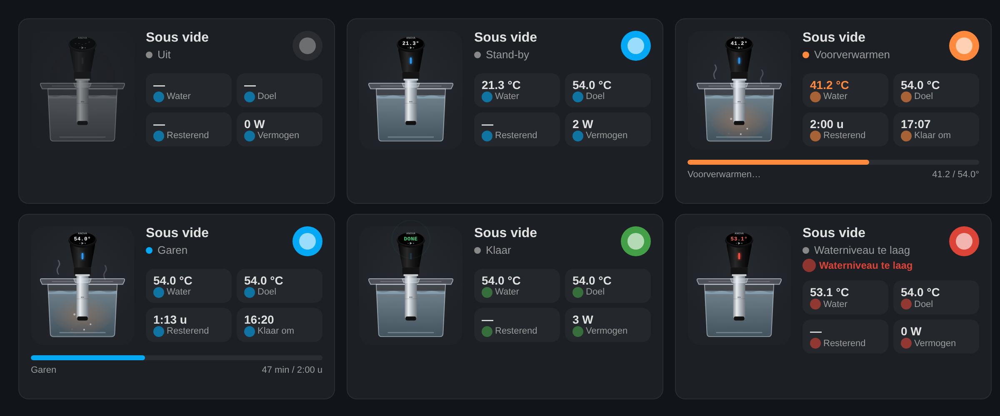

# Anova Sous Vide Card

An animated Lovelace card for the **Anova Precision Cooker** (sous vide stick) in Home Assistant, styled to match `custom:appliance-washer-card` from [ha-appliance-electromenager-cards](https://github.com/skyrotter/ha-appliance-electromenager-cards).



## Features

- Status: off, idle, preheating, cooking, holding, done, plus alerts (low water, too hot, device failure)
- Tiles: water temperature, target temperature, time remaining, "ready at" (or power)
- Progress bar: preheat progress (start temp → target) and cook progress (elapsed / cook time)
- Animated illustration: the stick's display shows the water temperature, the water glows while preheating, bubbles and steam while cooking
- Optional power button for a smart plug, with a two-tap confirmation before switching off
- Visual editor: configure the card from the dashboard UI (v1.1.0)
- Dutch and English labels

## Requirements

- The core Home Assistant [Anova integration](https://www.home-assistant.io/integrations/anova)
- Optional: a smart plug in front of the cooker (for the power button and power reading)

## Installation

[](https://my.home-assistant.io/redirect/marketplace_repository/?owner=nosehook&repository=anova-sous-vide-card&category=plugin)

<!-- ha-marketplace:exclude-start -->
### HACS / Marketplace (custom repository)
1. Add `https://github.com/nosehook/anova-sous-vide-card` as a custom repository, category **Dashboard**.
2. Install **Anova Sous Vide Card** and reload your browser.

### Manual
1. Copy `anova-sous-vide-card.js` to `/config/www/`.
2. Settings → Dashboards → ⋮ → Resources → add `/local/anova-sous-vide-card.js` as a **JavaScript module**.
<!-- ha-marketplace:exclude-end -->

## Configuration

Add the card from the card picker and use the visual editor, or in YAML:

```yaml
type: custom:anova-sous-vide-card
name: Sous vide
switch: switch.sous_vide          # optional: smart plug
power: sensor.sous_vide_power     # optional
```

| Option | Default | Description |
|---|---|---|
| `name` | `Sous vide` | Card title |
| `state` | `sensor.anova_precision_cooker_staat` ¹ | Cook state sensor (preheating / cooking / maintaining / timer_expired …) |
| `mode` | `sensor.anova_precision_cooker_modus` ¹ | Mode sensor (idle / cook / low_water / high_temp …) |
| `water_temp` | `sensor.anova_precision_cooker_watertemperatuur` ¹ | Water temperature |
| `target_temp` | `sensor.anova_precision_cooker_target_temperature` | Target temperature |
| `remaining` | `sensor.anova_precision_cooker_kooktijd_resterend` ¹ | Remaining cook time (s, min, h or `H:MM`) |
| `cook_time` | `sensor.anova_precision_cooker_kooktijd` ¹ | Total cook time (for the progress bar) |
| `switch` | – | Switch for the power button |
| `power` | – | Power sensor (W) |
| `energy` | – | Energy sensor (kWh), shown if no `power` |
| `confirm_off` | `true` | Ask for a second tap before switching off |
| `start_temp` | `20` | Starting water temperature for the preheat bar |
| `language` | `nl` | `nl` or `en` |

¹ Defaults are the entity IDs created on a Dutch-language install. On an English install set them explicitly, e.g. `sensor.anova_precision_cooker_state`, `..._mode`, `..._water_temperature`, `..._cook_time_remaining`, `..._cook_time`.

## License

MIT
